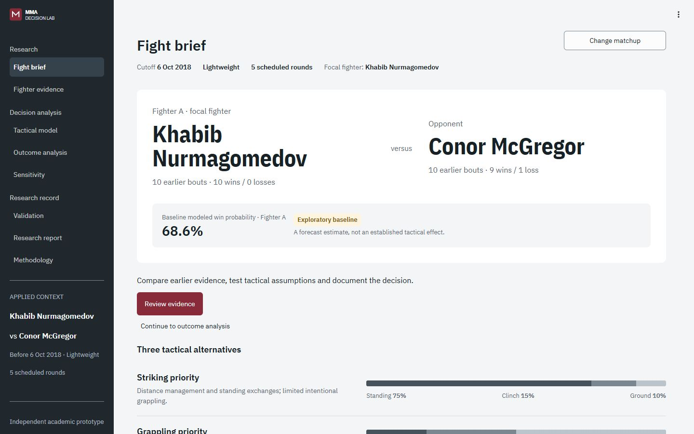

# MMA Decision Lab

**A working local research beta for pre-fight tactical decision analysis.** Python 3.11+, Streamlit, Pandas, NumPy, SciPy, scikit-learn, Plotly and Pydantic. English interface. Independent academic research prototype for SIE 422/522; not affiliated with or endorsed by UFC.

The application connects real earlier-date fight histories to a symmetric logistic forecast, then compares three **hypothetical, static** tactical priorities through an executable decision tree, expected utility, Monte Carlo integration and sensitivity analysis. Tactical effects are assumptions, not identified causal effects. The default effects are neutral. Weak forecasting evidence and unstable rankings produce **no robust tactical preference**.



**[Guía visual en español (PDF, 20 páginas)](output/pdf/MMA_Decision_Lab_Guia_Visual_de_Uso.pdf)** - capturas reales, pasos de uso, interpretación, glosario y guion de presentación.

## Run locally

After completing the clean installation below, start the app in PowerShell from the project directory:

```powershell
.\run.ps1
```

Open the local URL printed by Streamlit. The default example is **Khabib Nurmagomedov vs. Conor McGregor, before 2018-10-06**, with the entire fight date excluded. The historical bout selector also supports other retained matchups. Custom comparisons require two earlier eligible bouts for both fighters and a matching last division; otherwise select the clearly labeled scenario-only baseline.

## Clean installation

Use [uv](https://docs.astral.sh/uv/) with Python 3.11 or newer:

```powershell
git clone https://github.com/uainalaia/UFC-Decision-Analysis-Project.git
cd UFC-Decision-Analysis-Project
uv venv --python 3.12
uv pip sync requirements.lock
uv pip install --no-deps -e .
.venv/Scripts/python.exe scripts/fetch_snapshot.py
.venv/Scripts/python.exe scripts/train_baseline.py --as-of 2018-10-06
.venv/Scripts/python.exe -m streamlit run app/main.py
```

On macOS/Linux, use `.venv/bin/python` in place of `.venv/Scripts/python.exe`. The training command prepares the default historical baseline locally. For another cutoff, use **Prepare historical baseline** in Outcome analysis. Raw data, prepared models and the local virtual environment are generated during setup and are excluded from the repository.

`requirements.lock` pins all runtime/test dependencies with hashes. No dependency upgrades occur at startup. `fetch_snapshot.py` resolves the recorded upstream commit from `data/manifests/snapshot.json`; it downloads published GitHub CSV files and **does not scrape UFCStats**. Internet is needed only for initial dependency/data setup. Subsequent analysis and standalone HTML reports work offline.

To regenerate the lock intentionally: `uv pip compile pyproject.toml --extra dev --extra notebook --generate-hashes -o requirements.lock`.

## Reproduce, train and test

```powershell
.venv/Scripts/python.exe scripts/run_example_analysis.py
.venv/Scripts/python.exe scripts/run_example_analysis.py --illustrative
.venv/Scripts/python.exe scripts/run_example_analysis.py --config reports/generated/analysis.json --output reports/generated/reproduced
.venv/Scripts/python.exe scripts/train_baseline.py --as-of 2018-10-06
.venv/Scripts/python.exe -m pytest -q
.venv/Scripts/python.exe -m ruff check src app scripts tests
.venv/Scripts/python.exe -m ruff format --check src app scripts tests
```

The first example uses neutral effects. `--illustrative` deliberately enables hypothetical nonneutral assumptions. Outputs include an offline HTML report, strict JSON research record, result CSVs, ZIP bundle, model JSON, calibration and chronological partition audit. The notebook in `notebooks/worked_example.ipynb` includes a hand-verifiable tree example and the historical workflow. JSON model persistence stores numeric coefficients and scales; there is no pickle or arbitrary model upload.

## What is implemented

- Frozen archive hashes, entity/round validation, duplicate/identity checks, explicit exclusion logs, missing-value rules and provenance.
- Strictly pre-date profiles and vectorized historical features; same-day bouts are excluded together.
- Symmetric regularized logistic baseline, chronological train/validation/test blocks, regularization selection, proper scoring, reference models, calibration and bout bootstrap.
- Three policies, inspectable opponent-response assumptions, all terminal win/loss branches, expected utility, shared-draw simulation, paired differences, rank-first tie sharing and expected regret.
- One-way sensitivity with verified switching roots, tornado margin analysis, two-way decision regions and conservative robustness criteria.
- Eight Streamlit views, searchable matchup selection, safe local CSV snapshot upload, accessible grid tables and CSV/JSON/offline HTML/ZIP exports.
- Unit, temporal, statistical, reporting and full Streamlit workflow tests.

## Current research status

The frozen archive contains 8,962 input rows; 8,420 bouts survive the documented eligibility rules. The default pre-UFC-229 model is evaluated on 527 chronologically held-out bouts. Its Brier score is approximately 0.2425, compared with 0.25 for 50/50, but the bout-bootstrap interval for the difference includes zero. The baseline is therefore **exploratory**, and the application withholds a robust tactical preference. See [validation](docs/VALIDATION.md) and [model card](docs/MODEL_CARD.md).

This is a functional research beta, not a validated coaching prescription. Public retrospective records may contain corrections unavailable on the original reference date. Source checks establish archive provenance and internal consistency; a complete independent reconciliation against UFCStats is outstanding. Original-source reuse rights have not been independently established. Raw/processed data and supplied copyrighted papers are excluded from Git; provide an authorized local copy or use the documented published-archive acquisition boundary.

## Documentation

- [Guía visual de uso e interpretación (PDF, español)](output/pdf/MMA_Decision_Lab_Guia_Visual_de_Uso.pdf)
- [Fuentes y reconstrucción de la guía](output/pdf/README.md)
- [Rediseño v2: auditoría, comprobaciones y límites](docs/REDESIGN_V2_VALIDATION.md)
- [Decisiones visuales y estado de interacción v2](docs/REDESIGN_V2.md)
- [Galería antes/después](reports/review_v2/index.html)
- [Architecture](docs/ARCHITECTURE.md)
- [Mathematical methodology and defaults](docs/METHODOLOGY.md)
- [Data dictionary](docs/DATA_DICTIONARY.md)
- [Model card](docs/MODEL_CARD.md)
- [Validation and acceptance status](docs/VALIDATION.md)
- [Reproducibility](docs/REPRODUCIBILITY.md)
- [Research materials review](docs/RESEARCH_REVIEW.md)
- [Limitations](docs/LIMITATIONS.md)
- [Development log](docs/DEVELOPMENT_LOG.md)

Deployment, adaptive coaching, Markov-state reconstruction, causal effect estimation and additional predictive models are outside this beta. No wagering features are included.
