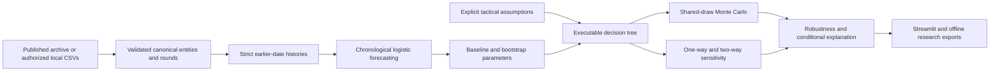

# Architecture

`src/mma_decision_lab` is independent of Streamlit:

| Module | Responsibility |
|---|---|
| `schemas.py` | Immutable Pydantic entities, context, policy simplex and bounded scenario validation |
| `data.py` | Byte-only CSV ingestion, source identity mapping, round validation, exclusions, hashes and provenance |
| `features.py` | Long histories, strict-date profiles and vectorized fighter/date cumulative features |
| `forecasting.py` | Symmetric logistic pipeline, chronological development and testing, scoring, calibration, bootstrap |
| `persistence.py` | Numeric JSON model serialization with feature-order/dimension validation |
| `decision.py` | Preset policies, log-odds effects, terminal branches and expected utility |
| `simulation.py` | Shared parameter draws, integrated utilities, paired comparisons, regret and numerical convergence |
| `sensitivity.py` | Parameter bounds, deterministic grids, verified roots, tornado and robustness |
| `analysis.py` | Context validation and framework-independent orchestration |
| `charts.py` | Plotly presentation of already calculated results |
| `reporting.py` | Escaped standalone HTML, strict JSON, CSV formula protection and in-memory ZIP |
| `config.py` | Version, paths, seed, history rule, colors and references |

`app/main.py` installs the shell and native navigation; `app/screens/` contains the eight page entry points and `app/views.py` their focused views. `app/ui.py` supplies shared presentation, `app/state.py` owns atomic applied/draft/result state, `app/context.py` binds each rerun to the applied configuration, and `app/resources.py` loads immutable cached resources. `theme.py`, `app/styles.css` and `.streamlit/config.toml` share the presentation tokens and local fonts.

Data are cached by content-derived snapshot token; explicitly prepared chronological models are cached by snapshot/cutoff. The default persisted numeric baseline is loaded without fitting. A result identity includes the dataset, actual model identity, fighter order, reference date, division/rounds, relevant baseline input, scenario/uncertainty, seed and draw count. Changed inputs expose a previous record until Run analysis; an exact recent configuration can recover its existing result. Drafts remain independent of page widget cleanup. Uploads modify the in-memory session, never write a supplied path or deserialize executable objects; applying a new snapshot clears prior results, models and exports.

The baseline is intentionally not retrained on every slider interaction. Feature generation groups observations by fighter/date before shifting cumulative totals, so same-day observations cannot leak. Tactical simulation never accesses the target outcome.

The CLI and UI call the same `analyze` service. Exports contain configuration, source hashes, implementation fingerprint, dependency versions and model evaluation. Safe JSON model artifacts are optional local outputs, not a prerequisite for app startup. No microservices, cloud account, live API or database server is required.
